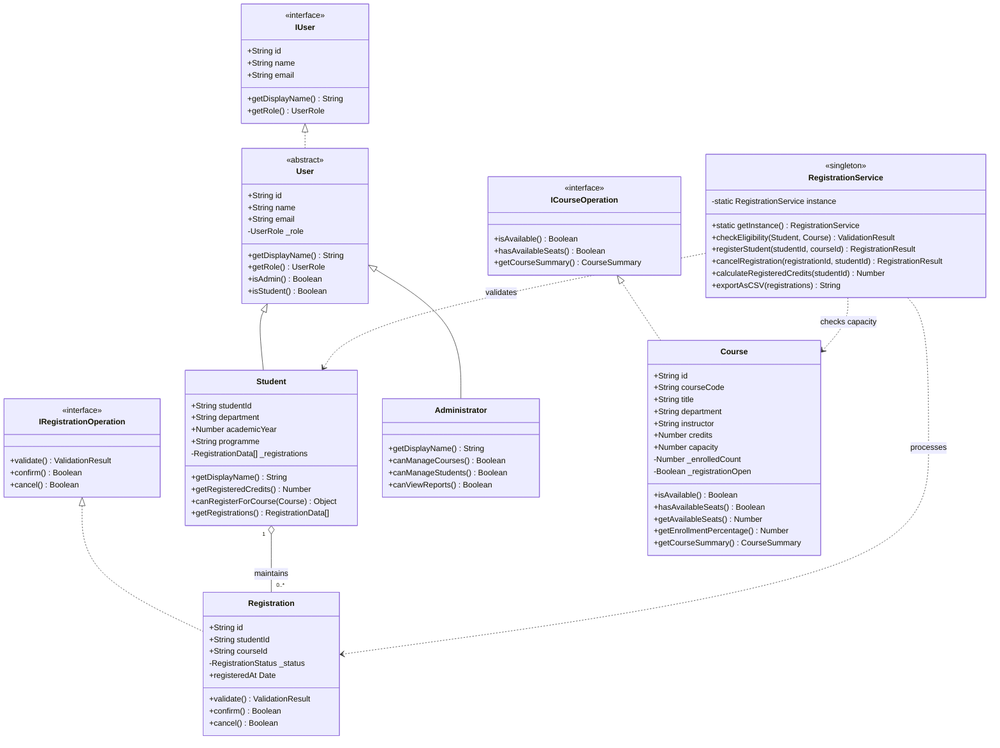
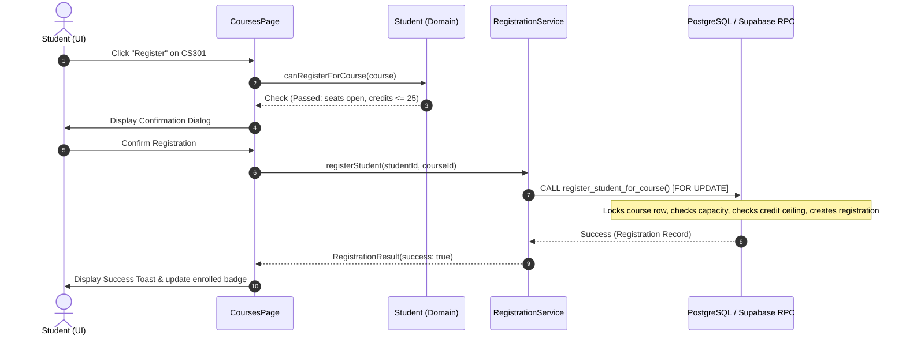

# CourseFlow — Course Registration and Enrollment Management System

> **Tagline:** "Your Courses. Your Semester. Your Future."  
> An academic Object-Oriented Programming (OOP) web application engineered for college course registration, student management, and institutional reporting.

---

## 1. Problem Statement & Project Objectives

Traditional academic course registration processes often suffer from concurrency bottlenecks, race conditions for limited seats, credit overload without automated constraints, and convoluted administration overhead. 

**CourseFlow** solves these challenges by providing:
- **Strict OOP Domain Modeling:** Core entities encapsulated within robust TypeScript domain classes implementing real polymorphism, abstraction, and inheritance.
- **Role-Based Workflows:** Distinct student experiences (course search, real-time credit tracking, one-click registration) and administrator portals (course lifecycle management, capacity controls, institutional analytics).
- **Persistent Backend & Atomic Operations:** Supabase PostgreSQL database architecture equipped with Row Level Security (RLS) and stored procedures guaranteeing thread-safe, atomic seat reservations without race conditions.
- **Built-in Demo Experience:** Instant full-fidelity demonstration mode out-of-the-box with realistic seed data across 4 departments, allowing offline evaluation and viva presentations.

---

## 2. Object-Oriented Programming (OOP) Architecture

The application strictly separates user interface logic from domain business rules by modeling the domain using classical OOP principles located in [`src/domain/models.ts`](file:///d:/linkedin/oops%20project/src/domain/models.ts) and [`src/domain/RegistrationService.ts`](file:///d:/linkedin/oops%20project/src/domain/RegistrationService.ts):

### A. Encapsulation
- **Internal State Protection:** Properties in `User`, `Student`, `Course`, and `Registration` use private fields (e.g. `_role`, `_registrations`, `_enrolledCount`, `_status`).
- **Mutation Control:** Direct state alteration is prohibited. State changes occur exclusively via validated class methods such as `canRegisterForCourse()`, `isAvailable()`, `hasAvailableSeats()`, and `confirm()`.

### B. Inheritance
- **Base Class `User`:** Implements common user identities (`id`, `name`, `email`) and core abstractions (`getDisplayName()`, `getRole()`).
- **`Student extends User`:** Inherits core user behavior while extending academic attributes (`studentId`, `department`, `academicYear`, `programme`, `_registrations`) and registration checks.
- **`Administrator extends User`:** Inherits `User` while exposing administrative privileges (`canManageCourses()`, `canManageStudents()`, `canViewReports()`).

### C. Abstraction
- **Interfaces Defining Contracts:**
  - `IUser`: Defines universal user contract.
  - `ICourseOperation`: Specifies contract for querying course availability and summaries (`isAvailable()`, `hasAvailableSeats()`, `getCourseSummary()`).
  - `IRegistrationOperation`: Defines lifecycle methods (`validate()`, `confirm()`, `cancel()`).

### D. Polymorphism
- Method overriding in action:
  - `User.getDisplayName()` outputs standard name.
  - `Student.getDisplayName()` overrides output to include Student ID: `Arjun Sharma (CS2024001)`.
  - `Administrator.getDisplayName()` overrides output to append badge: `Dr. Sarah Mitchell [Admin]`.
- Dynamic factory dispatch via `UserFactory.create()` returns polymorphic instances based on authenticated role.

### E. Service Layer & Design Patterns
- **Singleton Pattern:** `RegistrationService.getInstance()` ensures a unified coordinator for eligibility validation, transactional registrations, and report generation.
- **Factory Pattern:** `UserFactory` constructs `Student` or `Administrator` domain instances dynamically.

---

## 3. UML Diagrams

### UML Class Diagram


### Course Registration Sequence Diagram


---

## 4. Database Design & Security

The database schema is fully defined in [`supabase/migrations/001_init.sql`](file:///d:/linkedin/oops%20project/supabase/migrations/001_init.sql).

### Key Tables
1. **`profiles`**: Linked to Supabase Auth (`auth.users(id)`). Stores `full_name`, `student_id`, `department`, `programme`, `academic_year`, `role`.
2. **`courses`**: Stores course listings, credit ratings, instructors, capacities, and enrolled counts with unique constraints on `(course_code, semester)`.
3. **`course_prerequisites`**: Enforces course prerequisites with referential integrity.
4. **`registrations`**: Connects students to course offerings with a unique constraint on active registrations `(student_id, course_id)`.

### PostgreSQL Row Level Security (RLS) & Concurrency
- `profiles`: Students can read and update only their permitted profile fields. Role escalation to `admin` is blocked by RLS policies.
- `courses`: Authenticated users can view; only admins can execute `INSERT`, `UPDATE`, or `DELETE`.
- `registrations`: Students view exclusively their own records; administrators view system-wide registrations.
- **Race Condition Prevention:** The stored procedure `register_student_for_course` locks the course row via `SELECT ... FOR UPDATE`, ensuring that concurrent attempts to claim the last remaining seat never exceed course capacity.

---

## 5. Technology Stack

- **Frontend:** React 19, TypeScript, Vite.
- **Styling & Design Tokens:** Tailwind CSS v4, Lucide React icons.
- **UI Architecture:** Responsive sidebar, modals, confirmation dialogs, toast notifications, and skeleton loading states.
- **Backend & Database:** Supabase, PostgreSQL 15, Row Level Security, PL/pgSQL functions.
- **Visualization:** Recharts (Course capacity breakdown, Department enrollment, Registration statuses).
- **Form Validation:** React Hook Form & Zod.

---

## 6. Installation and Setup Instructions

### Prerequisites
- Node.js (v18.0.0 or higher)
- npm or pnpm

### Quick Start (Demo Mode)
1. Clone or navigate to the project directory:
   ```bash
   cd "d:/linkedin/oops project"
   ```
2. Install dependencies:
   ```bash
   npm install
   ```
3. Run the development server:
   ```bash
   npm run dev
   ```
4. Open your browser at `http://localhost:5173`.
5. Click **Student Demo** or **Admin Demo** on the login page to immediately test all workflows.

### Production Supabase Setup (Optional)
1. Create a project at [supabase.com](https://supabase.com).
2. Go to the **SQL Editor** in Supabase and run the migration script in `supabase/migrations/001_init.sql`.
3. Create a `.env` file in the project root:
   ```env
   VITE_SUPABASE_URL=https://your-project.supabase.co
   VITE_SUPABASE_ANON_KEY=your-anon-key
   ```
4. Restart the app (`npm run dev`). The system automatically transitions from Demo Mode to live database persistence.

---

## 7. Testing & Verification Checklist

| Test Scenario | Expected Outcome | Status |
|---------------|------------------|:------:|
| Student Registration Flow | One-click registration updates credit tally and seat count | Passed |
| Duplicate Enrollment Attempt | Blocked by domain validation and database uniqueness constraints | Passed |
| Credit Limit Enforced (25 max) | Enrollment rejected when total credits exceed 25 | Passed |
| Course Capacity Exhaustion | Registration button disabled for full courses; error modal if full | Passed |
| Registration Cancellation | Frees student credit balance and restores course capacity | Passed |
| Role-Based Navigation | Non-admin accounts cannot access `/admin` or `/admin/reports` | Passed |
| CSV Report Generation | Instant download of student and institutional registration records | Passed |
| Zero Build / Type Errors | `npm run build` generates optimized production bundle cleanly | Passed |
